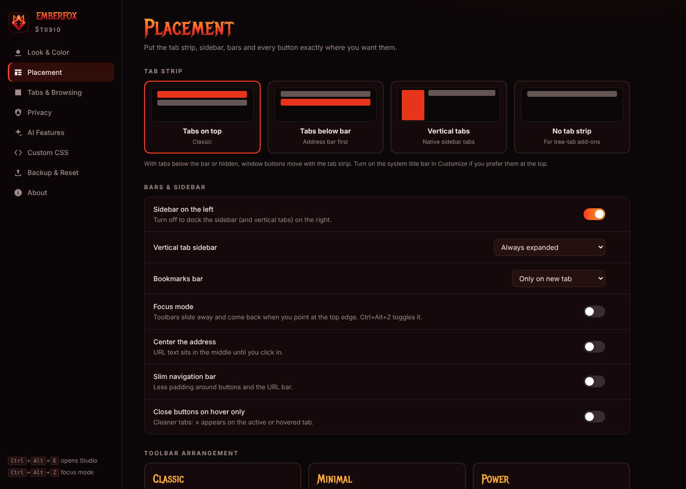

<p align="center">
  <br>
  
</p>

<p align="center"><b>Private by force. Yours by design.</b><br>
A Firefox-based browser for Linux with telemetry locked out at every layer and the deepest built-in customization of any Firefox fork.</p>

<p align="center">
  <a href="https://github.com/rxvy-dev/emberfox/releases/latest"></a>
  <a href="https://github.com/rxvy-dev/emberfox/actions/workflows/ci.yml"></a>
  <a href="LICENSE"></a>
  
</p>

<p align="center"><a href="https://github.com/rxvy-dev/emberfox/releases/latest"><b>⬇ Download for Linux</b></a></p>

---

## What makes it different

| | Emberfox |
|---|---|
| **Telemetry** | Every telemetry, study, experiment, attribution and crash-upload switch is **locked** off at the engine level (autoconfig `lockPref`), backed by enterprise policies. The crash reporter, ping sender and updater binaries are **deleted**. In source builds they're compiled out. A live **proof panel** in Studio shows each lock. |
| **Ember Studio** (`about:ember`) | A built-in control center. Every change applies **instantly** to all windows, no restart and no add-on. |
| **Color** | 10 hand-tuned themes · a full **7-surface palette editor** (frame, toolbar, URL bar, text, dim text, accent, glow) · **save unlimited named themes** · **share themes as a one-line code** (`ember:0b0607,…`) · a quick accent swap · light and dark · steps aside for AMO themes if you want |
| **Placement** | Tabs **top / below the bar / vertical / hidden** · sidebar left or right · collapsed-on-hover sidebar · bookmarks bar modes · **move any toolbar button** to the nav bar, tab strip, bookmarks bar, overflow menu or hidden, with ◀ ▶ reordering · one-click toolbar layouts (Classic / Minimal / Power) · hide 6 kinds of clutter |
| **Shape & feel** | Corner radius 0–20px · tab min and max width · density · interface font and size · ember glow · ember strip · ember loading bar · **focus mode** (toolbars slide away, Ctrl+Alt+Z) · centered URL · slim nav bar |
| **Privacy levels** | Balanced / Hardened / Fortress in one click, plus 25 fine-tune switches (DoH with Quad9, Mullvad, Cloudflare, NextDNS or custom · RFP · clear on exit · WebRTC · WebGL…) |
| **No junk** | No Pocket, sponsored tiles or stories, Firefox Suggest ads, VPN promos, "More from Mozilla", or default-browser nags. AI features are **blocked by default** (local translations stay available). |
| **Power users** | Custom CSS editor with live reload and snippets · `userChrome.css` works out of the box · export and import your whole setup (theme, saved themes, toolbars, privacy) as one JSON file |
| **Linux** | VA-API hardware video decoding toggles (NVIDIA via nvidia-vaapi-driver) · middle-click paste · X11 + Wayland · own Wayland app-id and window class |
| **Always current** | A new Emberfox is built and published automatically within hours of every Firefox release, so Mozilla's security fixes arrive fast. A built-in notifier (GitHub only, no identifiers, can be turned off) tells you when one is out. |

<p align="center">
  
  
  
  
</p>

---

## Install (every Linux distro)

Grab the files from the [latest release](https://github.com/rxvy-dev/emberfox/releases/latest). Check them with `sha256sum -c SHA256SUMS --ignore-missing`.

| Distro family | Package |
|---|---|
| **Any glibc distro** | `tar xf emberfox-*-linux-x86_64.tar.xz && cd emberfox && ./install.sh` (or `./install.sh --user`, no root) |
| **Any distro, no install** | `Emberfox-*.AppImage`: `chmod +x` and run |
| **Any distro, sandboxed** (incl. Alpine, Void-musl, Silverblue, SteamOS, NixOS) | `Emberfox.flatpak`: `flatpak install Emberfox.flatpak` |
| Debian · Ubuntu · Mint · Pop!_OS · Zorin · Kali | `sudo apt install ./emberfox_*_amd64.deb` |
| Fedora · RHEL · Alma · Rocky · openSUSE · Nobara | `sudo dnf install ./emberfox-*.rpm` / `sudo zypper in ./emberfox-*.rpm` |
| Arch · EndeavourOS · Manjaro · CachyOS · Garuda | `packaging/arch/PKGBUILD` (`emberfox-bin`) → `makepkg -si` |
| Void · Auxo | `packaging/void/template` → `./xbps-src pkg emberfox-bin` |
| Gentoo · Funtoo | `packaging/gentoo/emberfox-bin-*.ebuild` in a local overlay |

musl systems can't run Mozilla's prebuilt engine: use the Flatpak, or `./build.sh source`.

Emberfox keeps its own profile folder, separate from any Firefox you have. Firefox and Chrome data can be imported on first run.

---

## Build

```bash
./build.sh repack            # ~3 min: latest official Firefox → Emberfox tarball in dist/
./build.sh packages          # .deb / .rpm / Flatpak / AppImage from that tarball
./build.sh audit             # proves no telemetry path is left (binaries, locks, policies, identity)

./build.sh source --lto      # 1–3 h: compile from Mozilla source with telemetry compiled out
```

Options: `repack --version 160.0.1 --arch aarch64 --from <tarball|dir>` · `source --version X --pgo --git`

**Build dependencies:** `bash curl tar xz unzip python3 rsvg-convert (librsvg) ImageMagick`, plus `dpkg-deb` / `rpmbuild` / `flatpak-builder` for the matching packages.
Source builds also need ~40 GB disk and 16+ GB RAM. `mach bootstrap` fetches the Rust and Clang toolchains.

```
Arch:    sudo pacman -S --needed curl unzip python librsvg imagemagick
Debian:  sudo apt install curl unzip python3 librsvg2-bin imagemagick
Fedora:  sudo dnf install curl unzip python3 librsvg2-tools ImageMagick
Void:    sudo xbps-install curl unzip python3 librsvg-utils ImageMagick
```

### Two build paths, one result

```
             ┌─ repack ─ Mozilla's official Linux build (SHA512-verified)
             │            └ brandify: omni.ja strings, prefs, logos, icons
 Firefox ────┤
             └─ source ── Mozilla source + browser/branding/emberfox + mozconfig
                          (--disable-crashreporter --disable-updater, no telemetry reporting)
                                      │
                                      ▼
                     install_ember  (scripts/lib.sh)
                       • delete crashreporter / crashhelper / pingsender / updater
                       • defaults/pref/autoconfig.js → emberfox.cfg  (locked prefs + Studio boot)
                       • distribution/policies.json
                       • ember/  (Studio engine + about:ember)
                       • browser/application.ini (Emberfox identity, crash reporter off)
                                      │
                                      ▼
                tarball → deb · rpm · AppImage · Flatpak · PKGBUILD · xbps · ebuild
```

### Releases

Releases are fully automated by GitHub Actions:

- **CI** (`ci.yml`): tests, schema-checks policies, lints every script, then repacks the current Firefox and runs the telemetry audit on every push.
- **Release** (`release.yml`): push a tag like `v160.0.1-1` (or click *Run workflow*) to build x86_64 + aarch64 tarballs, `.deb`, `.rpm`, AppImage and Flatpak, audit them, and publish a GitHub Release with `SHA256SUMS`. It then commits updated checksums into the Arch, Void and Gentoo recipes.
- **Firefox watch** (`firefox-watch.yml`): every 6 hours, compares Mozilla's latest Firefox with the latest Emberfox and triggers a release when Firefox is newer.

Emberfox carries **zero engine patches**. Everything runs through Mozilla's supported customization layers (autoconfig, enterprise policies, branding, privileged chrome modules), so each new Firefox release can be repacked the day it ships.

---

## Layout

```
branding/        logo.svg, logo-small.svg (16–32 px), wordmark.svg, icons/, brand strings, emberfox-branding.js (baked defaults)
settings/        emberfox.cfg (locked telemetry kill + Studio boot), autoconfig.js, policies.json
ember/content/   boot.sys.mjs   engine: live repaint, about:ember, toolbar button, shortcuts, custom CSS
                 prefs.sys.mjs  themes, palette math, settings schema, privacy levels, placement presets
                 ui.css         browser-chrome styling, driven by root attributes
                 studio.*       the Ember Studio page
scripts/         build logic (repack, source, fetch, audit, shared lib)
packaging/       launcher, .desktop, install.sh, deb, rpm, Arch, Void, Gentoo, Flatpak, AppImage
tools/           brandify.py (rebrander), text2svg.py (wordmark), preview/ (Studio design preview)
tests/           node tests (palette, versions, cross-file consistency), policies schema check
.github/         CI, release and Firefox-watch workflows, issue and PR templates
mozconfig        source-build configuration
```

### Customizing Emberfox itself

- **New built-in theme:** add an entry to `THEMES` in `ember/content/prefs.sys.mjs`.
- **New Studio setting:** add the pref to `EMBER_PREFS`, toggle a root attribute in `boot.sys.mjs → paint()`, style it in `ui.css`, add a row in `studio.js`.
- **Change defaults:** `branding/emberfox-branding.js` (user-changeable) or `settings/emberfox.cfg` (locked).
- **Preview Studio's design in any browser:** `tools/preview/run.sh`, then open http://127.0.0.1:8765 (Firefox APIs are mocked).

## Shortcuts

| Keys | Action |
|---|---|
| Ctrl+Alt+E | Open Ember Studio |
| Ctrl+Alt+Z | Toggle focus mode |
| Ctrl+Alt+Shift+I | Browser Toolbox (inspect the UI for custom CSS) |

**If the `emberfox` launcher won't start** on your system, run `./firefox` from the install folder. It's the same browser, with a shared Firefox-style profile location. Please also [open an issue](https://github.com/rxvy-dev/emberfox/issues/new/choose) so it can be fixed.

---

## Contributing & security

See [CONTRIBUTING.md](CONTRIBUTING.md) and [SECURITY.md](SECURITY.md). Changes are tracked in [CHANGELOG.md](CHANGELOG.md).

## Legal

Emberfox is built from Mozilla Firefox source code and distributed under the [Mozilla Public License 2.0](LICENSE).
Firefox is a trademark of the Mozilla Foundation. Emberfox is not affiliated with or endorsed by Mozilla, and all Firefox branding is replaced.
Wordmark lettering and Studio headings use **Metal Mania** © Open Window, [SIL Open Font License 1.1](ember/content/fonts/OFL.txt).
