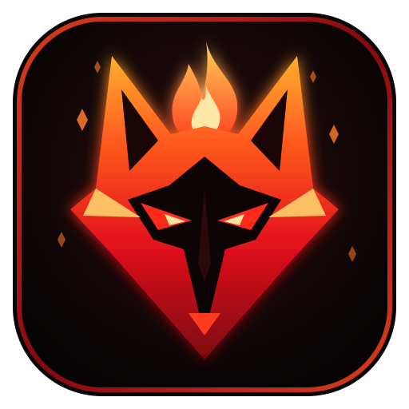
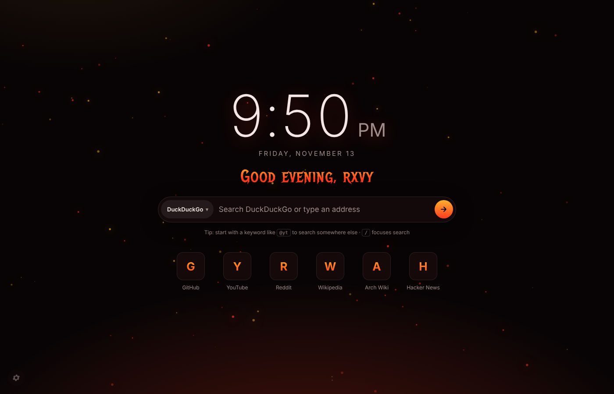
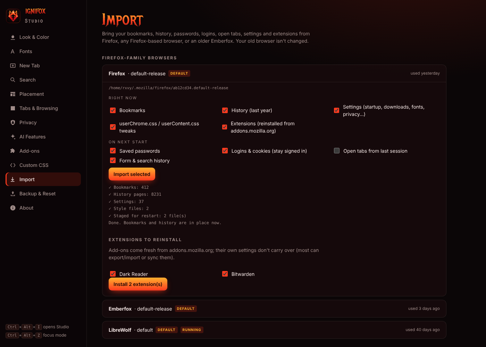
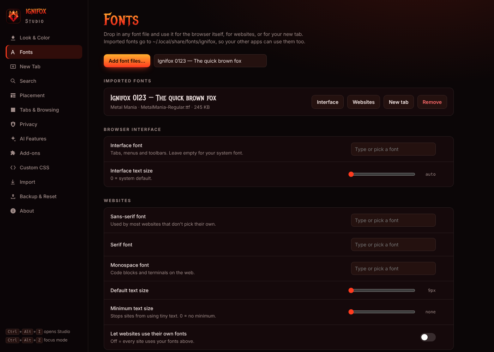
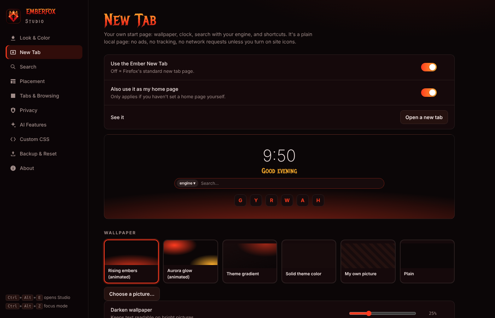
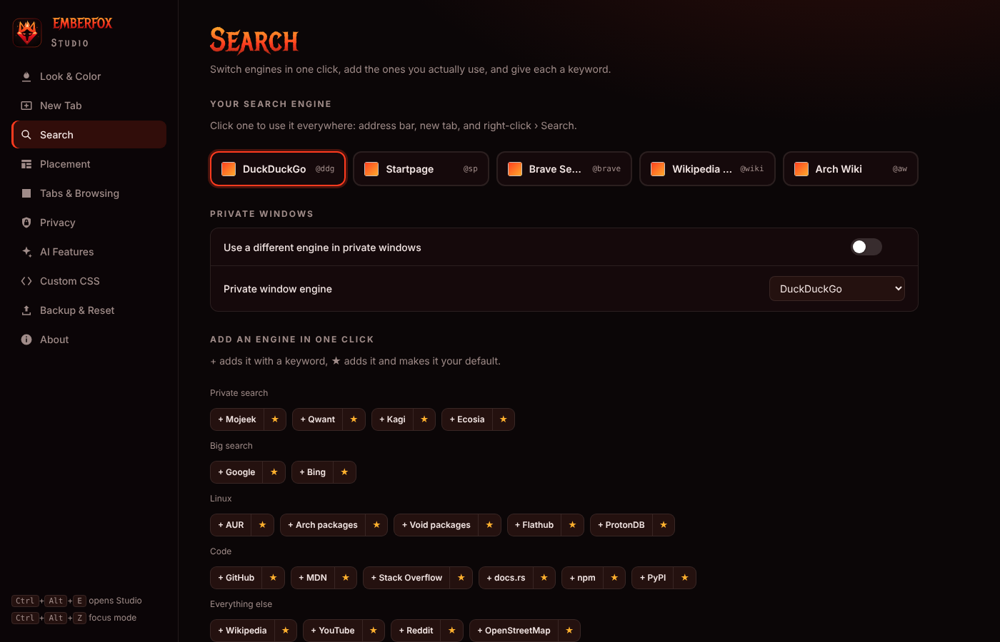
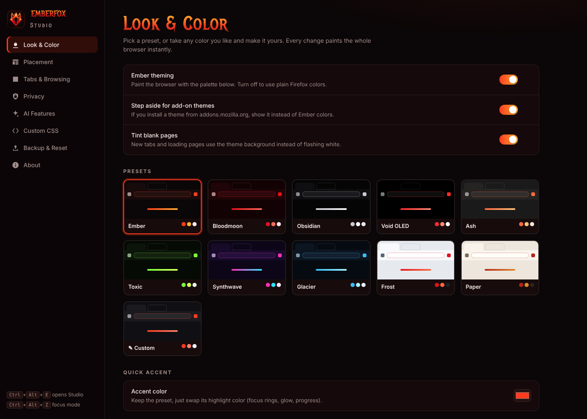
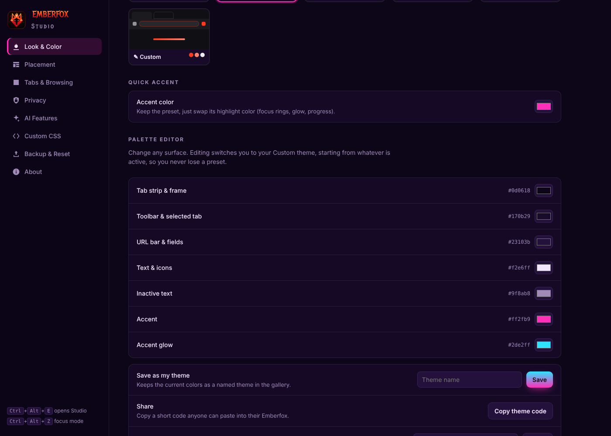
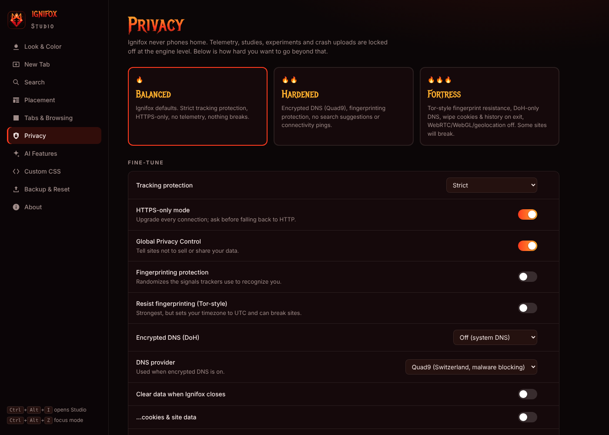
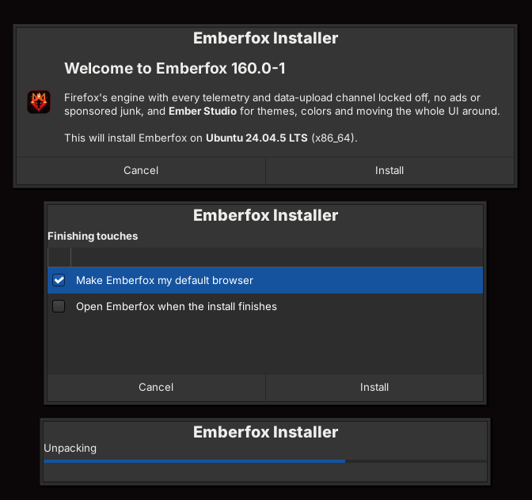

<p align="center">
  <br>
  
</p>

<p align="center"><b>Private by force. Yours by design.</b><br>
A Firefox-based browser for Linux with telemetry locked out at every layer and the deepest built-in customization of any Firefox fork.<br>
<sub><i>Ignifox</i>, from Latin <i>ignis</i> (fire). Its first release was called Emberfox; the installer upgrades it and keeps your settings.</sub></p>

<p align="center">
  <a href="https://github.com/rxvy-dev/ignifox/releases/latest"></a>
  <a href="https://github.com/rxvy-dev/ignifox/actions/workflows/ci.yml"></a>
  <a href="LICENSE"></a>
  
</p>

<p align="center"><a href="https://github.com/rxvy-dev/ignifox/releases/latest"><b>⬇ Download for Linux</b></a> · or paste this into a terminal:</p>

```bash
curl -fsSL https://raw.githubusercontent.com/rxvy-dev/ignifox/main/install.sh | bash
```

---

## What makes it different

| | Ignifox |
|---|---|
| **Telemetry** | Every telemetry, study, experiment, attribution and crash-upload switch is **locked** off at the engine level (autoconfig `lockPref`), backed by enterprise policies. The crash reporter, ping sender and updater binaries are **deleted**. In source builds they're compiled out. A live **proof panel** in Studio shows each lock. |
| **Ignifox Studio** (`about:ignifox`) | A built-in control center. Every change applies **instantly** to all windows, no restart and no add-on. |
| **Import** | Bring **bookmarks, history, passwords, logins/cookies, open tabs, form history, settings, userChrome.css and extensions** from Firefox (incl. Snap & Flatpak), LibreWolf, Waterfox, Floorp, Zen, Mullvad Browser or an older Emberfox. Profiles are found automatically and never changed. Chrome, Brave, Edge, Vivaldi and Opera go through the built-in importer. |
| **Fonts** | Drop in **.ttf / .otf / .ttc / .woff / .woff2** files and use them for the browser interface, for websites (sans/serif/mono, sizes, minimum size, force your fonts), or for the new tab clock and greeting. Imported fonts also work in every other app. |
| **One-click looks** | Classic, Zen-style, Arc-like, Chrome-like, Minimal, Hacker/TTY: theme, tab layout, shapes and spacing in one click. Plus **🎲 Surprise me** random themes that always stay readable. |
| **Ignifox New Tab** | Your own start page: big clock, date and a black-metal greeting with your name · search box with a per-search **engine switcher** and `@keyword` shortcuts · editable shortcut tiles (4 styles), optionally topped up from your most-visited sites · **wallpapers**: rising embers, aurora, gradient, solid, or your own picture with dim and blur · notes pad · 3 layouts. A plain local page: no ads, no tracking, no network requests unless you turn on site icons. Doubles as your home page. |
| **Search** | Switch your engine in **one click** · a different engine for private windows · **25 one-click engines** (Startpage, Brave, Kagi, Mojeek, Arch Wiki, AUR, Void packages, Flathub, ProtonDB, GitHub, MDN, docs.rs, YouTube…) with ★ to add-and-make-default · add any site with a `%s` URL · edit every engine's `@keyword` · suggestion and new-tab toggles |
| **Color** | 10 hand-tuned themes · a full **7-surface palette editor** (frame, toolbar, URL bar, text, dim text, accent, glow) · **save unlimited named themes** · **share themes as a one-line code** (`igni:0b0607,…`) · a quick accent swap · light and dark · steps aside for AMO themes if you want |
| **Tab strip** | A picture or accent gradient behind the tabs (like a Firefox theme header) with a darken slider · **multi-row tabs** · right-click menu clean-up (hide AI, send-to-device, screenshot, highlights and 10 more) |
| **Add-ons** | One-click installs of hand-picked open-source add-ons: Dark Reader, SponsorBlock, Sidebery, Bitwarden, DeArrow, Stylus, Privacy Badger and more |
| **Placement** | Tabs **top / below the bar / vertical / hidden** · sidebar left or right · collapsed-on-hover sidebar · bookmarks bar modes · **move any toolbar button** to the nav bar, tab strip, bookmarks bar, overflow menu or hidden, with ◀ ▶ reordering · one-click toolbar layouts (Classic / Minimal / Power) · hide 6 kinds of clutter |
| **Shape & feel** | Tab styles (pills, underline, boxy) · tab height · **floating page** (rounded card with a gap, Zen-style) · interface scale (90–200%) · 6 scrollbar styles · overlay scrollbars · compact menus · address bar max width · icon-only bookmarks · corner radius 0–20px · tab min and max width · density · interface font and size · tab glow · accent strip · flame loading bar · **focus mode** (toolbars slide away, Ctrl+Alt+Z) · centered URL · slim nav bar |
| **Privacy levels** | Balanced / Hardened / Fortress in one click, plus 25 fine-tune switches (DoH with Quad9, Mullvad, Cloudflare, NextDNS or custom · RFP · clear on exit · WebRTC · WebGL…) |
| **No junk** | No Pocket, sponsored tiles or stories, Firefox Suggest ads, VPN promos, "More from Mozilla", or default-browser nags. AI features are **blocked by default** (local translations stay available). |
| **Power users** | Custom CSS editor with live reload and snippets · `userChrome.css` works out of the box · export and import your whole setup (theme, saved themes, toolbars, privacy) as one JSON file |
| **Linux** | VA-API hardware video decoding toggles (NVIDIA via nvidia-vaapi-driver) · middle-click paste · X11 + Wayland · own Wayland app-id and window class |
| **Always current** | A new Ignifox is built and published automatically within hours of every Firefox release, so Mozilla's security fixes arrive fast. A built-in notifier (GitHub only, no identifiers, can be turned off) tells you when one is out. |

<p align="center"></p>
<p align="center">
  
  
</p>
<p align="center">
  
  
  
  
  
  
</p>

---

## Install (every Linux distro)

Paste one line into a terminal. A graphical installer opens (GTK on GNOME/XFCE/Cinnamon/Hyprland with zenity, Qt on KDE), downloads the latest release, verifies its checksum and installs it:

```bash
curl -fsSL https://raw.githubusercontent.com/rxvy-dev/ignifox/main/install.sh | bash
```
or with wget:
```bash
wget -qO- https://raw.githubusercontent.com/rxvy-dev/ignifox/main/install.sh | bash
```

<p align="center"></p>

- **Just for me** (no password, `~/.local`), **For everyone** (graphical password prompt, `/opt`), or **Flatpak**. musl systems get the Flatpak automatically.
- Run it again to **update** or **uninstall**. It detects an existing install.
- No GUI toolkit? It falls back to a terminal UI (whiptail/dialog) or plain prompts.
- Scripted: `… | bash -s -- --user --yes` · other flags: `--system --flatpak --uninstall --cli --no-launch --version v160.0.1-1`

### Or pick a package

Grab files from the [latest release](https://github.com/rxvy-dev/ignifox/releases/latest). Check them with `sha256sum -c SHA256SUMS --ignore-missing`.

| Distro family | Package |
|---|---|
| **Any distro (recommended)** | the one-line installer above |
| **Any glibc distro, by hand** | `tar xf ignifox-*-linux-x86_64.tar.xz && cd ignifox && ./install.sh` (or `./install.sh --user`, no root) |
| **Any distro, no install** | `Ignifox-*.AppImage`: `chmod +x` and run |
| **Any distro, sandboxed** (incl. Alpine, Void-musl, Silverblue, SteamOS, NixOS) | `Ignifox.flatpak`: `flatpak install Ignifox.flatpak` |
| Debian · Ubuntu · Mint · Pop!_OS · Zorin · Kali | `sudo apt install ./ignifox_*_amd64.deb` |
| Fedora · RHEL · Alma · Rocky · openSUSE · Nobara | `sudo dnf install ./ignifox-*.rpm` / `sudo zypper in ./ignifox-*.rpm` |
| Arch · EndeavourOS · Manjaro · CachyOS · Garuda | `packaging/arch/PKGBUILD` (`ignifox-bin`) → `makepkg -si` |
| Void · Auxo | `packaging/void/template` → `./xbps-src pkg ignifox-bin` |
| Gentoo · Funtoo | `packaging/gentoo/ignifox-bin-*.ebuild` in a local overlay |

musl systems can't run Mozilla's prebuilt engine: use the Flatpak, or `./build.sh source`.

Ignifox keeps its own profile folder, separate from any Firefox you have. Firefox and Chrome data can be imported on first run.

---

## Android

Ignifox for Android is the same idea on your phone: Mozilla's Gecko engine, no telemetry,
and **Ignifox Studio** built in. It shares its themes and its new tab page with the Linux
browser, so a theme code made on one works on the other.

**Get it:** download the APK from the [latest release](https://github.com/rxvy-dev/ignifox/releases/latest), open it, and allow your browser or file manager to install apps when Android asks.

| Your phone | File |
|---|---|
| Almost every phone from the last 8 years | [`ignifox-android-arm64.apk`](https://github.com/rxvy-dev/ignifox/releases/latest/download/ignifox-android-arm64.apk) |
| Older 32-bit phones | [`ignifox-android-arm32.apk`](https://github.com/rxvy-dev/ignifox/releases/latest/download/ignifox-android-arm32.apk) |
| x86 tablets, emulators, Waydroid | [`ignifox-android-x86_64.apk`](https://github.com/rxvy-dev/ignifox/releases/latest/download/ignifox-android-x86_64.apk) |

Android 8 or newer. For automatic updates, add `https://github.com/rxvy-dev/ignifox` to [Obtainium](https://obtainium.imranr.dev/).

| | |
|---|---|
| **Look** | All ten Ignifox themes, custom accent, one-tap looks, 🎲 Surprise me, theme codes shared with Linux, toolbar on top or bottom, rounded / pill / square address bar |
| **New tab** | The same Ignifox New Tab: animated wallpapers or your own picture, clock, greeting, shortcuts, search-engine switcher |
| **Search** | Pick the default engine or add any site as one |
| **Privacy** | Strict tracker blocking, HTTPS-only, Global Privacy Control and secure DNS choices, all on one screen. No telemetry, no crash upload |
| **Freedom** | No Google Play Services, Firebase or other closed libraries · any add-on from addons.mozilla.org · install add-ons from a file, unsigned ones if you allow it · `about:config` unlocked · zoom on every site |

Trade-offs of shipping without Google's libraries: no passkeys and no casting, and websites can't send push notifications while the app is closed.

The app lives in [`android/`](android/). It is built on Mozilla's open-source Android Components (the building blocks of Firefox for Android), starting from their reference browser. Build it yourself with `cd android && ./gradlew assembleNightly` (JDK 17+ and the Android SDK).

## Build

```bash
./build.sh repack            # ~3 min: latest official Firefox → Ignifox tarball in dist/
./build.sh packages          # .deb / .rpm / Flatpak / AppImage from that tarball
./build.sh audit             # proves no telemetry path is left (binaries, locks, policies, identity)

./build.sh source --lto      # 1–3 h: compile from Mozilla source with telemetry compiled out
```

Options: `repack --version 160.0.1 --arch aarch64 --from <tarball|dir>` · `source --version X --pgo --git`

**Build dependencies:** `bash curl tar xz unzip python3 rsvg-convert (librsvg) ImageMagick`, plus `dpkg-deb` / `rpmbuild` / `flatpak-builder` for the matching packages.
Source builds also need ~40 GB disk and 16+ GB RAM. `mach bootstrap` fetches the Rust and Clang toolchains.

```
Arch:    sudo pacman -S --needed curl unzip python librsvg imagemagick
Debian:  sudo apt install curl unzip python3 librsvg2-bin imagemagick
Fedora:  sudo dnf install curl unzip python3 librsvg2-tools ImageMagick
Void:    sudo xbps-install curl unzip python3 librsvg-utils ImageMagick
```

### Two build paths, one result

```
             ┌─ repack ─ Mozilla's official Linux build (SHA512-verified)
             │            └ brandify: omni.ja strings, prefs, logos, icons
 Firefox ────┤
             └─ source ── Mozilla source + browser/branding/ignifox + mozconfig
                          (--disable-crashreporter --disable-updater, no telemetry reporting)
                                      │
                                      ▼
                     install_ignifox  (scripts/lib.sh)
                       • delete crashreporter / crashhelper / pingsender / updater
                       • defaults/pref/autoconfig.js → ignifox.cfg  (locked prefs + Studio boot)
                       • distribution/policies.json
                       • studio/  (Studio engine + about:ignifox)
                       • browser/application.ini (Ignifox identity, crash reporter off)
                                      │
                                      ▼
                tarball → deb · rpm · AppImage · Flatpak · PKGBUILD · xbps · ebuild
```

### Releases

Releases are fully automated by GitHub Actions:

- **CI** (`ci.yml`): tests, schema-checks policies, lints every script, then repacks the current Firefox and runs the telemetry audit on every push.
- **Release** (`release.yml`): push a tag like `v160.0.1-1` (or click *Run workflow*) to build x86_64 + aarch64 tarballs, `.deb`, `.rpm`, AppImage and Flatpak, audit them, and publish a GitHub Release with `SHA256SUMS`. It then commits updated checksums into the Arch, Void and Gentoo recipes.
- **Firefox watch** (`firefox-watch.yml`): every 6 hours, compares Mozilla's latest Firefox with the latest Ignifox and triggers a release when Firefox is newer.

Ignifox carries **zero engine patches**. Everything runs through Mozilla's supported customization layers (autoconfig, enterprise policies, branding, privileged chrome modules), so each new Firefox release can be repacked the day it ships.

---

## Layout

```
install.sh       one-line graphical installer (curl | bash)
branding/        logo.svg, logo-small.svg (16–32 px), wordmark.svg, icons/, brand strings, ignifox-branding.js (baked defaults)
settings/        ignifox.cfg (locked telemetry kill + Studio boot), autoconfig.js, policies.json
studio/content/   boot.sys.mjs   engine: live repaint, about:ignifox, toolbar button, shortcuts, custom CSS
                 prefs.sys.mjs  themes, palette math, settings schema, privacy levels, placement presets
                 ui.css         browser-chrome styling, driven by root attributes
                 studio.*       the Ignifox Studio page
scripts/         build logic (repack, source, fetch, audit, shared lib)
packaging/       launcher, .desktop, install.sh, deb, rpm, Arch, Void, Gentoo, Flatpak, AppImage
tools/           brandify.py (rebrander), text2svg.py (wordmark), preview/ (Studio design preview)
tests/           node tests (palette, versions, cross-file consistency), policies schema check
.github/         CI, release and Firefox-watch workflows, issue and PR templates
mozconfig        source-build configuration
```

### Customizing Ignifox itself

- **New built-in theme:** add an entry to `THEMES` in `studio/content/prefs.sys.mjs`.
- **New Studio setting:** add the pref to `IGNI_PREFS`, toggle a root attribute in `boot.sys.mjs → paint()`, style it in `ui.css`, add a row in `studio.js`.
- **Change defaults:** `branding/ignifox-branding.js` (user-changeable) or `settings/ignifox.cfg` (locked).
- **Preview Studio's design in any browser:** `tools/preview/run.sh`, then open http://127.0.0.1:8765 (Firefox APIs are mocked).

## Shortcuts

| Keys | Action |
|---|---|
| Ctrl+Alt+I | Open Ignifox Studio |
| Ctrl+Alt+Z | Toggle focus mode |
| Ctrl+Alt+Shift+I | Browser Toolbox (inspect the UI for custom CSS) |

**If the `ignifox` launcher won't start** on your system, run `./firefox` from the install folder. It's the same browser, with a shared Firefox-style profile location. Please also [open an issue](https://github.com/rxvy-dev/ignifox/issues/new/choose) so it can be fixed.

---

## Contributing & security

See [CONTRIBUTING.md](CONTRIBUTING.md) and [SECURITY.md](SECURITY.md). Changes are tracked in [CHANGELOG.md](CHANGELOG.md).

## Legal

Ignifox is built from Mozilla Firefox source code and distributed under the [Mozilla Public License 2.0](LICENSE).
Firefox is a trademark of the Mozilla Foundation. Ignifox is not affiliated with or endorsed by Mozilla, and all Firefox branding is replaced.
Wordmark lettering and Studio headings use **Metal Mania** © Open Window, [SIL Open Font License 1.1](studio/content/fonts/OFL.txt).
